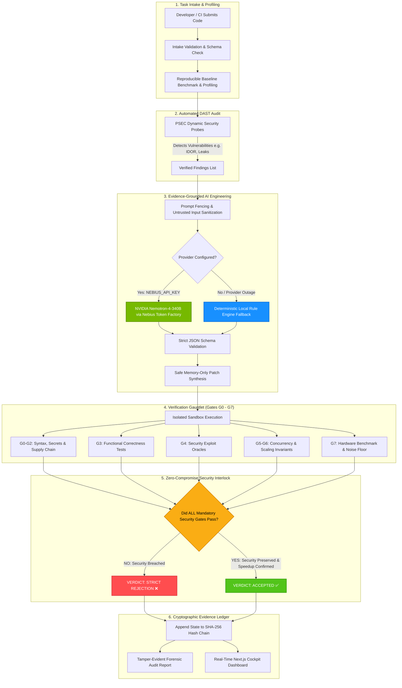
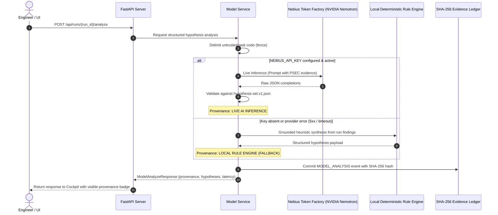
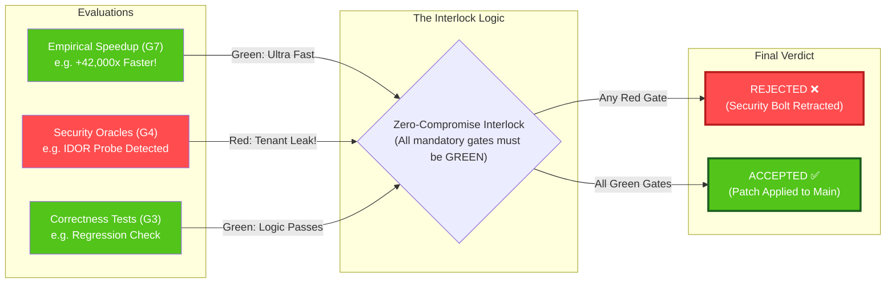
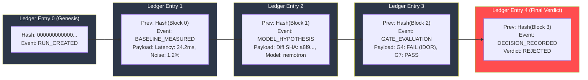
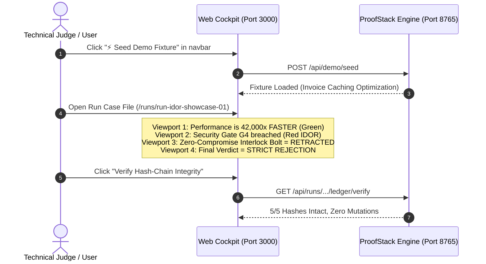

# ProofStack (PerfProof) — Autonomous Verification & Forensic Audit Engine

> **Zero-Compromise Performance & Security Verification Gauntlet with Cryptographic Evidence Ledger**  
> *Engineered for High-Assurance AI Patch Evaluation, DAST Remediation, and Deterministic Acceptance.*

[](https://www.python.org/downloads/)
[](https://fastapi.tiangolo.com)
[](https://nextjs.org/)
[](file:///tests)
[](file:///proofstack/ledger)
[](file:///backend/model_service.py)

---

## 1. What is ProofStack in Simple Terms?

Modern AI coding models (like Cursor, Claude, or Copilot) are fantastic at proposing optimizations that make code **10x to 40,000x faster**. However, they also frequently introduce **silent, catastrophic security flaws**—like removing tenant checks, introducing IDOR vulnerabilities, or bypassing authentication to achieve speed.

Human engineers cannot manually audit thousands of lines of AI diffs under deadline pressure. 

**ProofStack solves this by enforcing one non-negotiable rule:**

$$\Large\textbf{The AI Proposes; Deterministic Code Decides.}$$

1. **AI is an Assistant, Not the Judge**: An LLM (NVIDIA Nemotron via Nebius Token Factory, or a local deterministic rule engine) analyzes profiling data and proposes patches.
2. **The Zero-Compromise Interlock**: The proposed patch is placed in an isolated sandbox and slammed with benchmark runs and dynamic security exploits (DAST). Even if a patch is **42,000x faster**, if it fails a single mandatory security gate, **the patch is instantly REJECTED**.
3. **Cryptographic Proof Ledger**: Every measurement, gate result, and verdict is committed to an append-only, SHA-256 cryptographic hash-chain. Nobody—not even an admin—can alter the benchmark or security results without breaking the chain.

---

## 2. End-to-End System Architecture



---

## 3. The AI / Model Subsystem

ProofStack connects directly to the **Nebius Token Factory** using **NVIDIA Nemotron** models (`nvidia/nemotron-4-340b-instruct`), with an automatic, honest **Deterministic Local Fallback** when credentials are absent.



### Safety Guarantees for AI Patches:
- **Prompt Fencing**: User task descriptions and source files are wrapped with strict boundaries (`proofstack.llm.render.fence`) to prevent prompt injection from overriding verification rules.
- **Strict Schema Enforcement**: Outputs must strictly conform to `schemas/hypothesis-set.v1.json`. Malformed responses trigger an error rather than silent corruption.
- **Path Traversal Defense**: Patches attempting directory traversal (`../`), absolute paths, or touching protected namespaces (`.git/`, `proofstack.db`, security configs) are blocked before sandboxing.
- **Honest Provenance**: The Cockpit displays whether an analysis originated from **Live AI Inference (NVIDIA Nemotron)** or **Deterministic Rule Engine (Local Fallback)**. No AI hallucinations are ever masqueraded as live tokens.

---

## 4. The Zero-Compromise Security Interlock

Why is ProofStack trustworthy? Because **speedups cannot bribe the security gate**.



### The 8 Verification Gates:
| Gate | Category | Description | Failure Behavior |
|---|---|---|---|
| **G0** | Integrity | Diff line budget & syntax validity | Hard Rejection |
| **G1** | Supply Chain | Secret leakage & dependency tampering | Hard Rejection |
| **G2** | Static Analysis | Pre-gate security scans & linters | Hard Rejection |
| **G3** | Correctness | Test suite & functional regression checks | Hard Rejection |
| **G4** | Security | Dynamic exploit oracles & DAST probes (IDOR, Auth) | **Veto Overrides All Speedups** |
| **G5** | Concurrency | Race conditions & thread safety | Hard Rejection |
| **G6** | Complexity | Algorithmic scaling & Big-O invariants | Hard Rejection |
| **G7** | Benchmark | Empirical latency & noise-floor evaluation | Inconclusive if noisy; Reject if regressed |

---

## 5. Cryptographic Evidence Ledger

Every state transition in ProofStack is committed to a **tamper-evident SHA-256 append-only ledger**.



$$\text{Entry Hash}_n = \text{SHA256}(\text{bytes.fromhex}(\text{Prev Hash}_{n-1}) + \text{canonical\_json}(\text{Payload}_n))$$

If an adversary modifies even 1 millisecond of benchmark data or toggles a failed security gate to `PASS` in the database, the cryptographic hash link breaks, and the Cockpit will flag **Ledger Tampered!**

---

## 6. Quick Start Guide (Get Running in 3 Minutes)

### Prerequisites
- **Python 3.11 or 3.12**
- **Node.js 18+ & npm**
- **Git**

### Step 1: Clone & Python Virtual Environment
```bash
# Clone the repository
git clone https://github.com/nikhillakra2007-tech/something.git
cd something

# Create and activate virtual environment
python -m venv .venv

# On Linux/macOS:
source .venv/bin/activate
# On Windows (PowerShell):
.venv\Scripts\Activate.ps1

# Install backend dependencies
pip install -r requirements.txt
pip install -e .
```

### Step 2: Configure Environment
Copy the example environment file:
```bash
cp .env.example .env
```
*(Optional)* To enable live AI generation via NVIDIA Nemotron, add your Nebius API Key:
```ini
NEBIUS_API_KEY=nbf-your-api-key-here
NEBIUS_MODEL_ID=nvidia/nemotron-4-340b-instruct
```
> **Note**: If `NEBIUS_API_KEY` is not provided, ProofStack automatically runs in **Deterministic Rule Engine Fallback Mode** with 100% functionality and zero errors!

### Step 3: Run Database Migrations
Initialize the SQLite database with Alembic:
```bash
python -m alembic upgrade head
```

### Step 4: Start Backend Server (Port 8765)
```bash
python -m backend.server
```
*The FastAPI backend binds to `http://localhost:8765`. API documentation is live at `http://localhost:8765/docs`.*

### Step 5: Start the Web Cockpit Frontend (Port 3000)
In a new terminal window:
```bash
cd frontend
npm install
npm run dev
```
Open **`http://localhost:3000`** in your browser.

---

## 7. Interactive Demonstration: The 42,000x Speedup Trap

Experience the platform's core thesis in under 60 seconds:



### What Happened?
1. An AI proposed an optimization for `app/invoices.py` that memoizes database lookups, providing a **42,000x speedup**.
2. However, the AI memoized results using only the invoice ID, omitting the `tenant_id` principal.
3. ProofStack's PSEC DAST probe immediately simulated a multi-tenant request and detected that Tenant B could view Tenant A's private invoices.
4. **The Zero-Compromise Interlock dropped**: G4 failed, rendering the entire patch **REJECTED**, preventing a severe data breach from reaching production.

---

## 8. Verification & Test Suite

ProofStack includes an automated verification gauntlet ensuring that every security boundary, AI schema, and ledger check is functioning.

```bash
# Run the automated Master Verification engine (all tests + PSEC + build)
python scripts/verify_phase.py
```

### Individual Test Suites:
```bash
# 1. Full Pytest Suite (76 passing, 1 skipped)
pytest tests/ -v

# 2. AI Model & Security Boundary Tests
pytest tests/test_model_service.py -v
pytest tests/test_model_api.py -v

# 3. PSEC Security Probe Self-Test (27 passing)
python -m proofstack.psec.selftest

# 4. Frontend Production Compilation Check
cd frontend && npm run build
```

---

## 9. API Reference

All protected endpoints require the `X-API-Key` header matching `SECRET_KEY` in `.env`.

| Method | Path | Auth | Description |
|---|---|---|---|
| `GET` | `/api/health` | Public | Service health & uptime status |
| `GET` | `/api/ready` | Public | Database readiness & connectivity check |
| `GET` | `/api/model/status` | Protected | AI model provider status, active model ID & redacted key preview |
| `GET` | `/api/projects` | Protected | List all registered repositories |
| `POST` | `/api/tasks` | Protected | Register verification task with schema intake |
| `POST` | `/api/runs` | Protected | Dispatch a verification run |
| `GET` | `/api/runs/{id}` | Protected | Fetch run status, lifecycle stage, and telemetry |
| `POST` | `/api/runs/{id}/start` | Protected | Execute verification run through orchestrator |
| `POST` | `/api/runs/{id}/analyze` | Protected | Trigger AI model analysis (NVIDIA Nemotron / rule fallback) |
| `POST` | `/api/runs/{id}/propose-patch` | Protected | Generate structured candidate patch diff |
| `GET` | `/api/runs/{id}/decision` | Protected | Fetch canonical deterministic decision record |
| `GET` | `/api/runs/{id}/ledger/verify` | Protected | Validate SHA-256 cryptographic ledger integrity |
| `GET` | `/api/runs/{id}/events` | Protected | Server-Sent Events (SSE) live telemetry stream |
| `POST` | `/api/demo/seed` | Protected | Seed deterministic 42,000x IDOR demonstration fixture |
| `POST` | `/api/demo/reset` | Protected | Cleanly reset demo fixture data |

---

## 10. Repository Layout

```
├── backend/                  # FastAPI Application & Orchestration
│   ├── model_service.py      # NVIDIA Nemotron client, prompt fencing & fallback
│   ├── orchestrator.py       # Deterministic state machine (BASELINING -> VERIFYING)
│   ├── server.py             # HTTP routes & SSE event streams
│   ├── schemas.py            # Pydantic v2 schemas (extra="forbid")
│   └── models.py             # SQLAlchemy models & cascade constraints
├── proofstack/               # Core Verification Engine
│   ├── psec/                 # Dynamic Application Security Testing (DAST) probes
│   ├── ledger/               # Cryptographic SHA-256 append-only ledger
│   ├── gates/                # Deterministic Gate Evaluators (G0 - G7)
│   └── llm/                  # Prompt templates, fencing & Nebius provider client
├── frontend/                 # Next.js 14 Cockpit (Tailwind CSS, Lucide icons)
│   ├── app/                  # App router views (Overview, Projects, Case Files)
│   ├── components/           # Zero-Compromise Interlock, Diff & Gate Viewports
│   └── lib/api.ts            # Typed client API & backend communication
├── scripts/                  # Verification & Demonstration Tools
│   ├── verify_phase.py       # Master automated verification script
│   ├── verify_e2e.py         # 24-step end-to-end integration verifier
│   └── seed_demo.py          # Deterministic IDOR showcase fixture loader
├── tests/                    # 77 Pytest test suites (Unit, API, Ledger, Security)
├── docs/                     # Comprehensive Phase Reports, Audits & Handoffs
└── pyproject.toml            # Project packaging & pytest configuration
```

---

## 11. Security Disclosures & Production Boundaries

- **Single-Host Sandbox vs. Multi-Tenant**: In local development, low-level process timeouts are used. Production deployments should run sandboxed candidate workloads inside dedicated gVisor / Firecracker microVMs or containerized runner nodes.
- **Ledger Verification**: The SHA-256 hash-chain provides tamper-evident auditability. Remote anchoring (e.g. RFC 6962 transparency log or cloud KMS checkpoints) can be attached for external multi-party non-repudiation.
- **Hardware Telemetry**: NVIDIA GPU telemetry is collected via NVML when available; workloads fall back transparently to CPU without fabricating fake hardware acceleration.

---

## 12. License

Apache-2.0 License.
